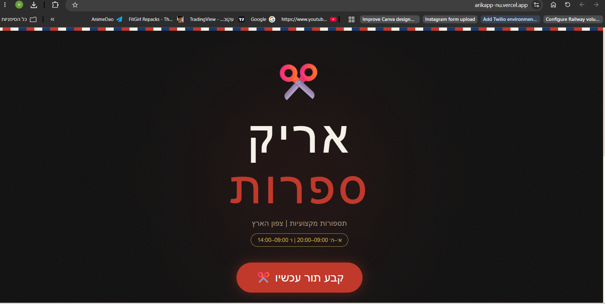
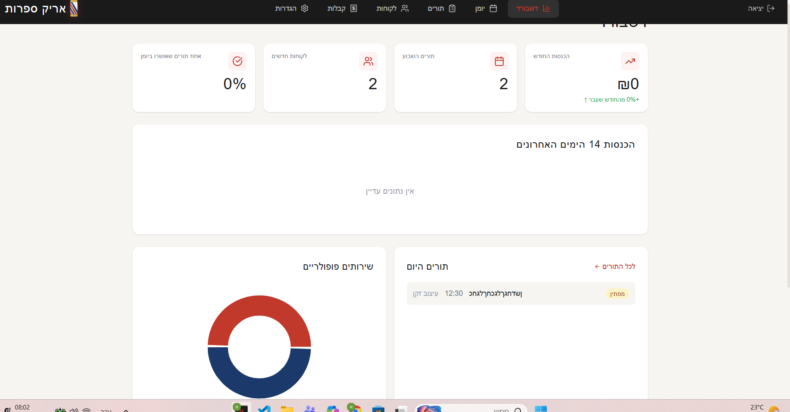
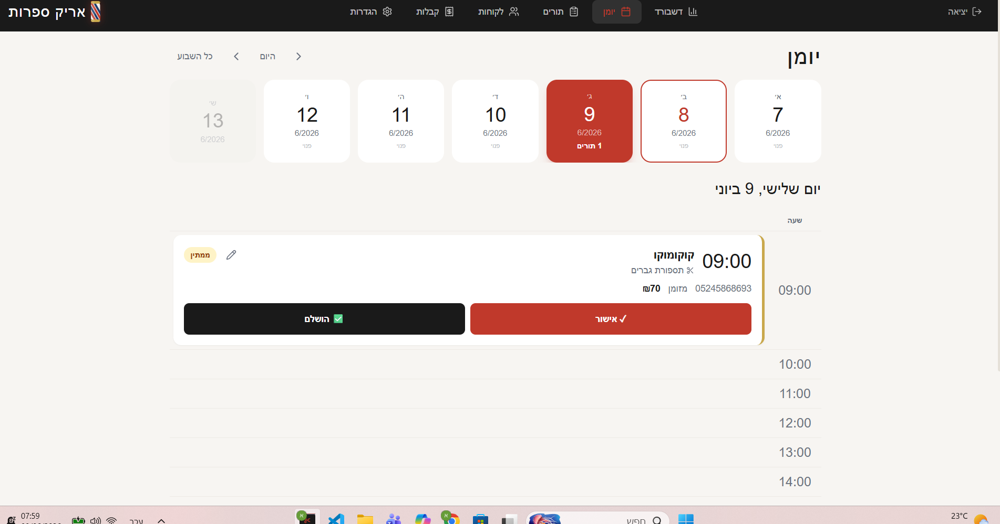
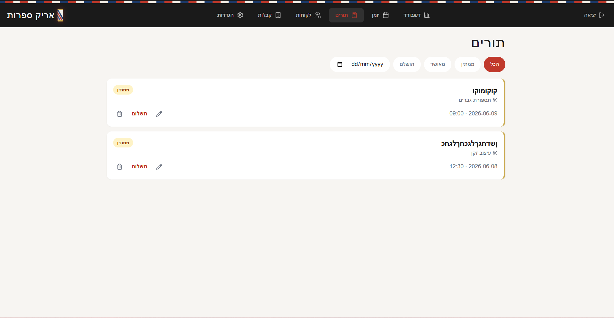
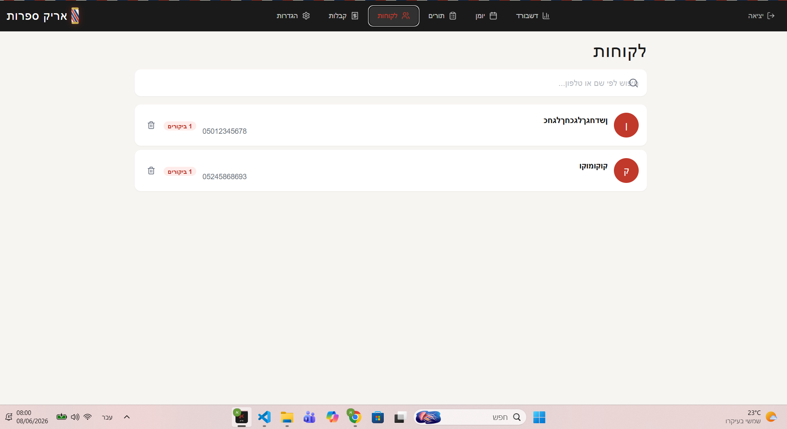

# ArikApp — Barbershop Booking PWA

**A full-stack, mobile-first appointment-booking app for a barbershop — public self-booking on one side, a complete management panel for the barber on the other.** Built solo with Next.js + Supabase. Real database, real auth, realtime updates, installable as a PWA. Hebrew / RTL throughout.

🔗 **Live:** [arikapp-nu.vercel.app](https://arikapp-nu.vercel.app/)

<!-- These five image files live in the repo root, next to this README. -->











---

## What it is

Two apps in one, sharing a live database:

- **Public booking page** *(dark theme)* — a walk-in customer books a haircut or beard appointment in three steps: pick a service → pick a date & time from live availability → enter name & phone → confirmed, with a summary and a confetti finish.
- **Admin panel** *(light theme, password-protected)* — the barber watches that booking appear **in real time**, then confirms it, completes it, and generates a receipt — alongside a full dashboard, calendar, customer list, and settings.

The two-tone identity (dark storefront, light back-office) is deliberate, and the whole thing installs to a phone home screen as a PWA.

---

## The booking flow (customer side)

- **3-step wizard** with a progress bar — service, details, confirm. *(Working)*
- **Live availability** — reads the shop's working hours and already-booked slots from the database, with a **realtime subscription** so a slot disappears the moment someone else takes it. Saturdays disabled. *(Working)*
- **Returning-customer recognition** — dedupes by phone number, and flags it if a phone is already registered under a different name. *(Working)*
- **Double-booking guard** — re-checks the slot at the instant of insert, so two people can't grab the same time. *(Working)*
- **Rate limiting** — caps booking attempts per phone to stop spam. *(Working — in-memory)*
- **Payment method selection** (cash / Bit / PayBox) — captured as a label on the appointment; **no money is actually charged** (see honest notes). *(Display-only)*

---

## The admin panel (barber side)

Six working sections, all driven by live data:

- **Dashboard** — monthly revenue, weekly appointments, new customers, and completion-rate KPIs, plus a 14-day revenue chart and a popular-services breakdown. *(Working)*
- **Calendar** — week and day views with distinct mobile and desktop layouts, and realtime toast notifications when a new booking lands. *(Working)*
- **Appointments** — filter by status/date, edit, delete, record payment. *(Working)*
- **Customers** — searchable list with visit counts and a per-customer history page showing total spent. *(Working)*
- **Receipts** — auto-created when an appointment is completed, grouped by customer, searchable, and **printable / downloadable as a PDF** generated in the browser. *(Working)*
- **Settings** — editors for services and per-day working hours. *(Working — with one caveat noted below.)*

---

## Automation & notifications

- **WhatsApp** (via Twilio) — appointment confirmations, cancellations, and daily reminders to customers. Code-complete and credentialed; gracefully no-ops if unconfigured. *(Wired, ready)*
- **Daily reminder cron** — a scheduled job runs every morning and sends reminders, protected by a secret. *(Working)*
- **Email** (Resend) and **Telegram admin alerts** — fully coded, currently dormant because their keys aren't configured yet. *(Code-complete, inactive)*

---

## Tech stack

| Layer | Choice |
|---|---|
| **Framework** | Next.js 14 (App Router), TypeScript |
| **UI** | React 18, Tailwind CSS, a local shadcn-style component set, Framer Motion |
| **Database / Auth / Realtime** | Supabase (hosted Postgres) |
| **PWA** | `next-pwa` service worker with runtime caching, full manifest + icons |
| **Charts** | Recharts |
| **PDF** | `jsPDF` (client-side receipts) |
| **Notifications** | Twilio (WhatsApp), Resend (email), Telegram, Vercel Cron |
| **Deploy** | Vercel |

**Scope:** ~5,000 lines of TypeScript/TSX across ~30 files, 14 routes (booking, receipt view, and an 11-page admin), 6 API route handlers, and 3 core database tables (customers, appointments, receipts).

---

## Honest notes

What's demo-grade and what production would need — being straight about it:

- **No real payments.** Payment method is recorded as a label; there's no gateway and nothing is charged. Receipts even state they aren't tax invoices. A production version would integrate a real payment/invoicing provider.
- **Open database policies.** Row-level security is enabled but set to allow-all (`USING (true)`) — explicitly demo-only. **Before running this for a real shop with real customer data, these need to be locked down** so the public key can't read every customer's details. This is the first thing I'd harden.
- **Incomplete migration file.** The code uses a couple of tables (`services`, `working_hours`) and a column that aren't in the committed schema — they were added manually in the Supabase console. A fresh clone needs those created before settings fully work. Worth committing a complete migration.
- **Settings source-of-truth mismatch.** The admin can edit services, but the public booking page currently reads from a hardcoded service list, so admin edits don't yet flow through to customers. Wiring the booking page to the services table is a clean fix.
- **Dormant integrations** — email and Telegram are coded but not yet keyed.

Listing these is deliberate — knowing the distance between a working build and a production system is part of the job.

---

## Running it

Required environment variables (names only):

```
NEXT_PUBLIC_SUPABASE_URL
NEXT_PUBLIC_SUPABASE_ANON_KEY
NEXT_PUBLIC_ADMIN_EMAIL
CRON_SECRET
```

Optional (WhatsApp / email / Telegram):

```
TWILIO_ACCOUNT_SID  TWILIO_AUTH_TOKEN  TWILIO_WHATSAPP_FROM  ADMIN_WHATSAPP_NUMBER
RESEND_API_KEY
TELEGRAM_BOT_TOKEN  TELEGRAM_CHAT_ID
```

```bash
npm install
# create .env.local, then run supabase/schema.sql against your Supabase project
# (also create the services & working_hours tables — not yet in the schema file)
npm run dev                    # local dev
npm run build && npm run start # production
```

---

<sub>Designed and built solo — booking flow, admin panel, database, auth, and integrations — using Claude Code.</sub>
